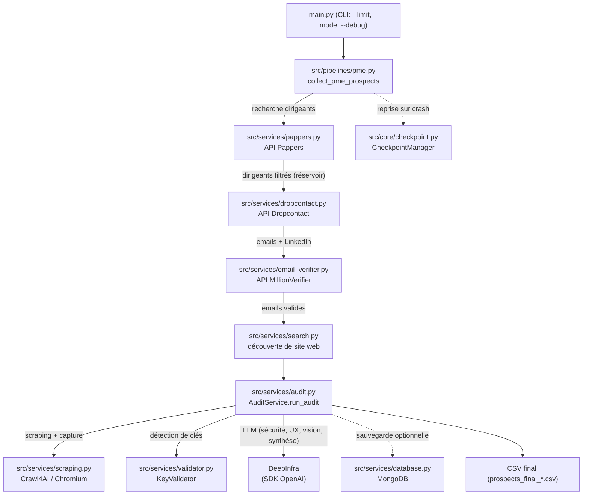

# Architecture

## Vue d'ensemble

Pipeline de prospection B2B en ligne de commande. À partir de critères de
ciblage (code NAF ou objet social, départements), il recherche des dirigeants
d'entreprises via l'API Pappers, enrichit leurs coordonnées (email, LinkedIn)
via Dropcontact, valide les emails via MillionVerifier, puis réalise un audit
technique automatisé de leur site web (sécurité, UX/code, visuel) à l'aide de
modèles de langage hébergés chez DeepInfra. Le résultat est un fichier CSV de
prospects qualifiés et enrichis des conclusions d'audit.

Le code est organisé en un seul point d'entrée (`main.py`) qui déclenche le
pipeline PME (`src/pipelines/pme.py`).

## Flux du pipeline

## Organisation du code

Tout le code exécuté vit dans `src/` ; `main.py` est le seul point d'entrée.
`src/utils/web.py` (`extract_domain`) et `clean_text` /
`contains_suspicious_keyword` de `src/utils/text.py` ne sont pas appelés par le
pipeline PME actuel.

## Table des modules (code vivant)

| Chemin | Responsabilité |
| --- | --- |
| `main.py` | Point d'entrée CLI, orchestration haut niveau, déduplication et export CSV final |
| `src/config/settings.py` | Configuration centrale : clés API, mode de prospection, codes NAF, départements, limites, chemins de cache |
| `src/config/logging_config.py` | Configuration du logger `prospection_pipeline` |
| `src/config/pricing.py` | Grille de coûts par modèle LLM et calcul du coût d'un appel |
| `src/config/prompts.py` | Prompts par défaut des 4 étapes d'audit (sécurité, UX/code, vision, synthèse) |
| `src/config/templates.py` | Modèles d'icebreakers et d'automatisations par code NAF (fallback) |
| `src/models/prospect.py` | `UnifiedProspect` : dataclass représentant un prospect enrichi |
| `src/core/checkpoint.py` | `CheckpointManager` : sauvegarde/reprise d'état sur disque |
| `src/core/rate_limiter.py` | `RateLimiter` : limitation du débit par API (fenêtre glissante 60 s) |
| `src/core/retry.py` | `http_request_with_retry` : appels HTTP avec retry exponentiel et jitter |
| `src/pipelines/pme.py` | Pipeline principal PME : réservoir, collecte, enrichissement, audit, export |
| `src/services/pappers.py` | Recherche de dirigeants via l'API Pappers |
| `src/services/dropcontact.py` | Enrichissement email/LinkedIn par batch via Dropcontact (polling) |
| `src/services/email_verifier.py` | Validation des emails via MillionVerifier |
| `src/services/search.py` | Découverte du site web (domaine email, puis recherche DuckDuckGo) |
| `src/services/scraping.py` | Scraping Crawl4AI (contenu) et scraping d'audit (HTML + capture full-page) |
| `src/services/audit.py` | `AuditService` : orchestration de l'audit LLM multi-étapes |
| `src/services/validator.py` | `KeyValidator` : détection et test de clés API exposées |
| `src/services/database.py` | `DatabaseService` : persistance MongoDB (optionnelle) |
| `src/utils/text.py` | Nettoyage de markdown et détection de contenu bruité |
| `src/utils/web.py` | Extraction de domaine (non utilisé par le pipeline actuel) |

## Services externes

| Service | Rôle | Variable d'environnement | Module appelant |
| --- | --- | --- | --- |
| Pappers | Recherche de dirigeants et d'entreprises par NAF/objet social, filtres (effectif, forme juridique, département) | `PAPPERS_API_KEY` | `src/services/pappers.py` |
| Dropcontact | Enrichissement : email professionnel, LinkedIn, à partir du nom + société + SIREN | `DROPCONTACT_API_KEY` | `src/services/dropcontact.py` |
| MillionVerifier | Validation temps réel de la délivrabilité des emails | `MILLION_VERIFIER_API_KEY` | `src/services/email_verifier.py` |
| DeepInfra | Fournisseur LLM (via SDK OpenAI). Modèles texte/code et vision pour les 4 étapes d'audit | `DEEPINFRA_API_KEY` | `src/services/audit.py` |
| MongoDB | Stockage optionnel des prospects, prompts et audits (dégrade proprement si indisponible) | `MONGODB_URI` / `MONGO_URI` | `src/services/database.py` |
| DuckDuckGo (HTML) | Recherche de site web quand le domaine email ne suffit pas (pas de clé) | — | `src/services/search.py` |
| Crawl4AI + Chromium | Scraping du site, navigation « smart discovery » et capture PDF/image full-page | — | `src/services/scraping.py` |
| APIs tierces testées par KeyValidator | ~40 services (Stripe, Google Maps, AWS, GitHub, SendGrid…) : requêtes de validation des clés détectées sur le site audité | — (clés trouvées, pas de clé propre) | `src/services/validator.py` |

## Modèle de données

`src/models/prospect.py` définit la dataclass `UnifiedProspect` :

- Identité / contact : `segment`, `prospect_name`, `company_name`, `email`,
  `website`, `linkedin`, `instagram`, `location`, `source`, `notes`.
- Icebreakers : `icebreaker_a` à `icebreaker_d` (champs présents, alimentés de
  façon marginale par le pipeline actuel).
- Audit : `audit_decision` (GO / NO_GO / PENDING / ERROR), `audit_score`
  (priorité 0-100), `audit_summary`, `audit_alerts` (nombre d'alertes
  sécurité), `audit_tech_report`, `audit_ui_report`, `audit_vision_report`.

En interne, le pipeline manipule surtout des dictionnaires (issus de Pappers /
Dropcontact) et ne convertit en `UnifiedProspect` qu'en fin de parcours.

## Checkpoint / reprise

`src/core/checkpoint.py` (`CheckpointManager`, répertoire `checkpoints/`) :

- Écrit un fichier JSON horodaté par étape
  (`checkpoint_<segment>_<timestamp>.json`) et un `checkpoint_metadata.json`
  pointant sur le dernier checkpoint.
- Chaque checkpoint porte un `campaign_id` (dérivé des codes NAF ou d'un hash
  des stratégies objet social). À la reprise, un checkpoint d'une autre campagne
  est ignoré.
- Le pipeline sauvegarde après la boucle principale, après l'enrichissement web
  et après l'audit (`phase` dans `progress_info`), ce qui permet de sauter les
  étapes déjà faites en cas de relance.
- En fin de run réussi, `main.py` appelle `clear_checkpoints()` pour vider le
  répertoire.

## Limitation de débit / retry

- `src/core/rate_limiter.py` : compteur par API sur une fenêtre de 60 s
  (`pappers` 30/min, `dropcontact` 3600/min, `default` 60/min) ; attend si le
  plafond est atteint.
- `src/core/retry.py` : retry exponentiel avec jitter (3 tentatives par défaut),
  retry sur 429 et 5xx, pas de retry sur les erreurs client 4xx.
- Dropcontact fonctionne en mode polling (délais croissants jusqu'à ~7 min par
  batch) ; les erreurs 401/402/403 lèvent une exception « quota épuisé » qui
  arrête la collecte.

## Sorties (fichiers écrits)

- `prospects_final_<timestamp>.csv` — fichier principal, écrit par `main.py`
  dans le répertoire courant (prospects dédupliqués, colonnes = champs de
  `UnifiedProspect`).
- `reservoir_pme.csv` — historique des dirigeants bruts collectés (persistant).
- `reservoir_filtre_<code_naf>.json` / `reservoir_filtre_cache.json` — cache des
  prospects valides non consommés.
- `strategies_testees_cache.json` — cache des objets sociaux testés (mode objet
  social, péremption 30 jours).
- `pagination_naf.json` — curseurs de pagination par stratégie NAF.
- `checkpoints/` — checkpoints de reprise (voir plus haut).
- `debug_screenshot_<siren>.jpg` — capture de la page auditée, écrite par
  `audit.py` pour vérification.
- `.crawl4ai_cache/` — cache de Crawl4AI.
- Optionnel : documents MongoDB (collections `prospects`, `prompts`, `audits`).

La plupart de ces fichiers sont ignorés par `.gitignore`.

## Configuration : variables d'environnement

Lues via `os.getenv`. « Requis » = le code ne fonctionne pas sans (pas de valeur
par défaut utilisable).

| Variable | Défaut | Requis |
| --- | --- | --- |
| `PAPPERS_API_KEY` | `None` | Oui (collecte) |
| `DROPCONTACT_API_KEY` | `None` | Oui (enrichissement) |
| `MILLION_VERIFIER_API_KEY` | `None` | Oui (validation email) |
| `DEEPINFRA_API_KEY` | `None` | Oui (audit) |
| `MONGODB_URI` (sinon `MONGO_URI`) | `mongodb://localhost:27017` | Non (DB optionnelle) |
| `MODE_PROSPECTION` | `code_naf` | Non |
| `CRAWL_ALLOW_NOISY` | `true` | Non |
| `LIMIT_MEMORY_MB` | `512` | Non |
| `RESERVOIR_PME_CSV` | `reservoir_pme.csv` | Non |
| `RESERVOIR_FILTRE_CACHE` | `reservoir_filtre_pme.json` | Non |
| `STRATEGIES_CACHE_FILE` | `strategies_testees_cache.json` | Non |
| `PAGINATION_NAF_FILE` | `pagination_codes_naf.json` | Non |
| `PAPPERS_MAX_PAGES` | `4` | Non |
| `PAPPERS_MAX_RESULTS` | `400` | Non |
| `DROPCONTACT_BATCH_SIZE_MAX` | `100` | Non |
| `DROPCONTACT_OVERSAMPLE` | `1` | Non |
| `PME_TARGET_DEFAULT` | `40` | Non |

## Limites connues / dette technique

- **Pas de tests automatisés** dans le dépôt.
- **Modèles LLM de l'audit codés en dur** : `src/services/audit.py` fixe ses
  propres modèles (code et vision) et l'URL de l’API ; ils ne sont pas configurables.
- **Logs très verbeux** : `src/core/retry.py` émet des logs `INFO` `[DEBUG]` à
  chaque requête ; `logging_config.py` affiche tout en console niveau DEBUG.
- **`KeyValidator` à patterns larges** : plusieurs patterns regex sont très
  génériques (ex. 32/40 caractères hexadécimaux), ce qui peut provoquer des
  faux positifs et des requêtes de test inutiles vers des APIs tierces.
- **Couplage import tardif** : plusieurs imports sont faits à l'intérieur des
  fonctions (`scraping.py`, `audit.py`, `main.py`), ce qui masque les
  dépendances réelles et complique la lecture.
- **Export CSV partiel dans le pipeline** : `pme.py` construit un `df_final`
  mais ne l'exporte pas lui-même (commentaire « logique export simplifiée ») ;
  l'export réel est fait par `main.py`.
- **Champs `icebreaker_*`** présents dans le modèle mais peu ou pas alimentés
  par le flux d'audit actuel.
